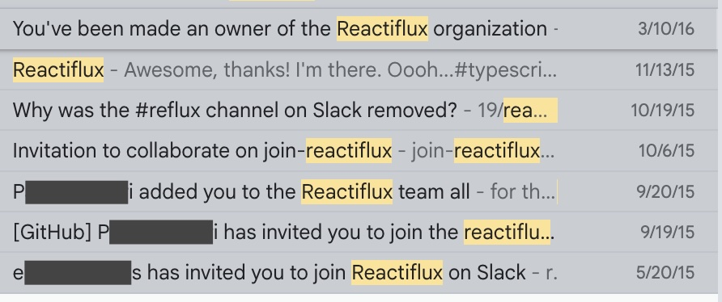

[Play Discord Simulator](https://vcarl.github.io/discord-game)

I stumbled across a silly little [PhD Simulator](https://research.wmz.ninja/projects/phd/index.html) game the other day. It follows the path of a grad student pursuing a PhD, balancing burnout against forward progress, your advisor's mood, and the paper submission process.

It reminded me viscerally of my experience in becoming a community leader, and I was inspired to fork it. This is vibe coded, but hey it's all a rules engine so I didn't have to revise almost any code. I've played through it a few times and found it challenging enough to be fun, anyway.

I found myself joining an online community in 2015 because I needed peers to chat with about the nuts-and-bolts of the work I was doing, and none of my colleagues were doing similar work. I was raised by an Eagle Scout, so I live by the policy of Leave It Better Than You Found It; it turns out that's all that was needed in 2015 to get noticed and offered access. Three months later, I was invited to the GitHub org. Six months after that, I was made an owner of the GitHub org, and was writing policy documents and handbooks for the other moderators. 

What started as a space where I could make friends asynchronously and talk shop turned into somewhere that I cared about the broader social dynamics; it helped me, and I wanted it to keep being a place that helped people. So when there was drama between regulars, I'd help mediate. When the mods disagreed about required actions, I'd argue my point and listen. I'd look for possible problems on the horizon and try to mitigate them.

I've burned out on it a dozen times, but I've never quit. I've stepped up, recruited others, automated solutions, stepped back, and returned so many times, always quietly and privately, always in small ways, because it's about the community — not me. 

I don't think a lot of people appreciate the challenge and struggle here, so I made this little game to express that. 

[Play it here ✨](https://vcarl.github.io/discord-game)

What my mod friends have said:

> I got offered mod and quit the game, too real

> this might be a little too real, lmao

> I think it's time for me to touch some grass now

